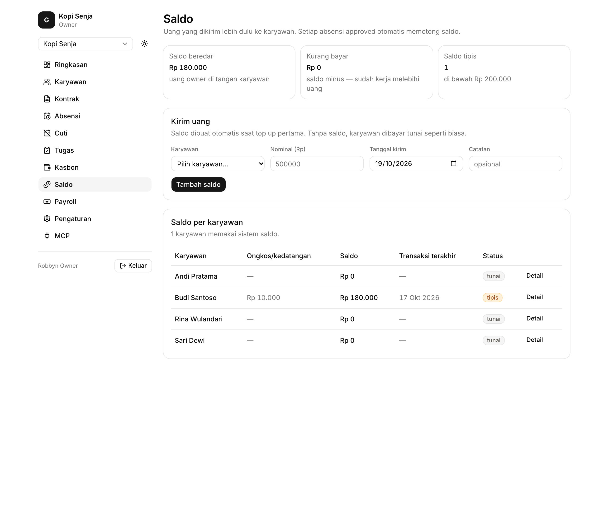
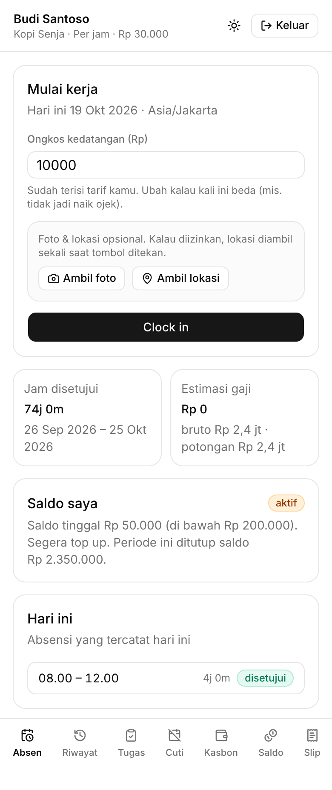
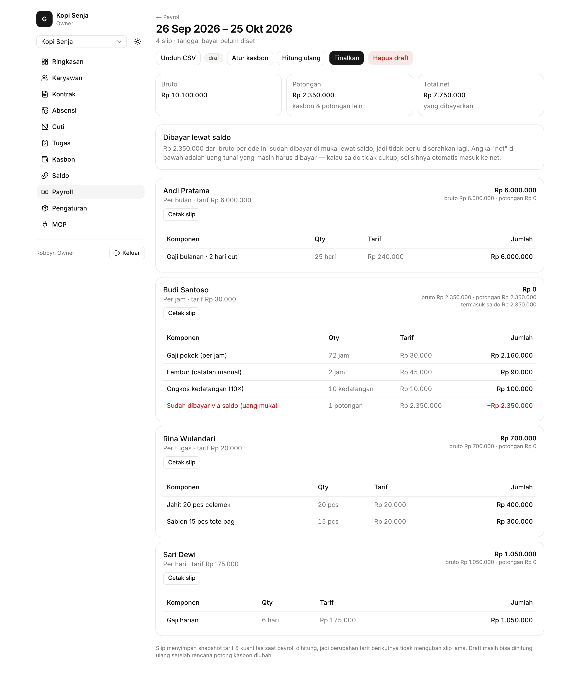
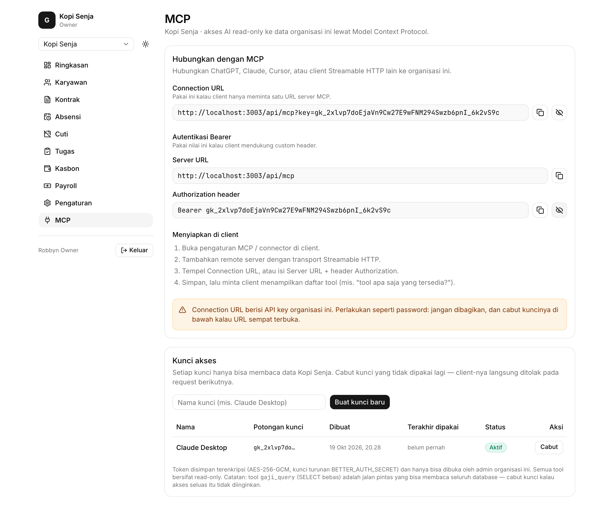

# Gaji

**Gaji** adalah aplikasi penggajian dan pengelolaan tenaga kerja multi-tenant untuk bisnis kecil. Kelola data karyawan, kontrak, absensi, upah tugas, kasbon, dan slip gaji dalam satu aplikasi.

Gaji menyediakan dashboard terpisah untuk administrator dan karyawan. Tampilan karyawan dirancang agar nyaman digunakan melalui perangkat seluler, termasuk untuk mencatat jam masuk dan pulang.

## Tampilan aplikasi

| Dashboard admin | Dashboard karyawan |
| --- | --- |
|  |  |
| **Kelola saldo dan permintaan karyawan** | **Lihat pekerjaan dan informasi penghasilan** |

| Payroll | Integrasi AI melalui MCP |
| --- | --- |
|  |  |
| **Tinjau payroll sebelum disetujui** | **Hubungkan tool read-only ke klien AI** |

## Fitur

- Kelola beberapa organisasi dari satu akun.
- Catat data karyawan, kontrak, dan riwayat upah.
- Kelola absensi dengan fitur clock-in dan clock-out karyawan, termasuk dukungan PWA.
- Pantau upah berbasis tugas, kasbon, dan transaksi saldo karyawan.
- Siapkan payroll dan terbitkan slip gaji dengan snapshot nilai upah dan kuantitas.
- Hubungkan klien AI melalui server [Model Context Protocol (MCP)](https://modelcontextprotocol.io) read-only.

## Teknologi

- Next.js 15 dengan App Router dan React 19
- PostgreSQL dengan Drizzle ORM
- Better Auth
- Tailwind CSS v4

## Menjalankan secara lokal

### Kebutuhan

- Node.js dan npm
- PostgreSQL 16, atau Docker untuk menjalankannya secara lokal

### Persiapan

Jalankan PostgreSQL lokal, misalnya dengan Docker:

```bash
docker run --name gaji-postgres \
  -e POSTGRES_USER=gaji \
  -e POSTGRES_PASSWORD=gaji \
  -e POSTGRES_DB=gaji \
  -p 5432:5432 \
  -d postgres:16-alpine
```

Dari direktori utama repo, pasang dependensi dan siapkan konfigurasi:

```bash
npm install
cp .env.example .env.local
```

Jika PostgreSQL berjalan di host atau port lain, sesuaikan `DATABASE_URL` di `.env.local`. Setelah itu, sinkronkan schema, isi data demo, dan jalankan server:

```bash
npm run db:push
npm run db:seed
npm run dev
```

Buka [http://localhost:3000](http://localhost:3000).

### Akun demo

Script seed membuat dua organisasi contoh dan akun berikut. Masukkan nomor HP dan PIN pada halaman login.

| Akun | Nomor HP | PIN | Jenis upah / akses |
| --- | --- | --- | --- |
| Owner | `0811111111` | `111111` | Akses Kopi Senja dan Bakery Pagi |
| Budi | `0822222222` | `222222` | Per jam |
| Sari | `0833333333` | `333333` | Per hari |
| Andi | `0844444444` | `444444` | Per bulan |
| Rina | `0855555555` | `555555` | Per tugas |
| Tono | `0866666666` | `666666` | Bakery Pagi |

Akun ini hanya untuk data demo lokal. Jangan gunakan kredensial tersebut di lingkungan produksi.

## Perintah npm

| Perintah | Keterangan |
| --- | --- |
| `npm run dev` | Jalankan server pengembangan. |
| `npm run build` | Build aplikasi untuk produksi. |
| `npm run start` | Jalankan server produksi. |
| `npm run db:push` | Sinkronkan schema Drizzle dengan PostgreSQL. |
| `npm run db:generate` | Buat migrasi SQL di direktori `drizzle/`. |
| `npm run db:studio` | Buka Drizzle Studio. |
| `npm run db:seed` | Reset dan isi organisasi serta data demo. |
| `npm run mcp` | Jalankan server MCP read-only melalui stdio. |
| `npm run mcp:smoke` | Jalankan pemeriksaan tool MCP melalui stdio. |
| `npm run mcp:smoke:http` | Periksa endpoint MCP Streamable HTTP. |
| `npm run mcp:key` | Lihat, buat, atau cabut API key MCP. |

## Integrasi MCP

Gaji menyediakan data payroll dan tenaga kerja secara read-only untuk klien AI yang kompatibel melalui endpoint Streamable HTTP `/api/mcp`. Connection URL berbentuk `<APP_URL>/api/mcp/<KEY>`, jadi client cukup diberi satu URL tanpa header (header `Authorization: Bearer` dan bentuk lama `?key=` tetap didukung). Halaman **MCP** di dashboard admin (`/admin/mcp`) menampilkan informasi koneksi dan menyediakan pengelolaan API key. Setiap key dibatasi untuk satu organisasi.

Tool MCP mencakup ringkasan harian, absensi, antrean persetujuan, pratinjau payroll, kasbon, kontrak yang akan berakhir, dan audit log. Query dijalankan dalam transaksi database read-only dengan batas waktu 20 detik.

Untuk mencoba endpoint HTTP secara lokal, jalankan aplikasi, buat API key dari halaman `/admin/mcp`, lalu jalankan:

```bash
npm run mcp:smoke:http -- --port 3000
```

Detail transport, autentikasi, dan konfigurasi klien tersedia di [`mcp/README.md`](mcp/README.md).

## Struktur proyek

```text
src/
  app/
    admin/          Dashboard administrator
    employee/       Dashboard karyawan
    api/auth/       Handler Better Auth
    api/switch-org/ Fitur ganti organisasi
    login/          Login nomor HP dan PIN
  db/               Schema Drizzle, koneksi database, dan seed
  lib/              Autentikasi, akses tenant, payroll, dan audit
  components/       Komponen UI bersama
```

## Catatan desain

- Item slip gaji menyimpan snapshot kuantitas, tarif, dan jumlah agar perubahan tarif tidak mengubah slip terdahulu.
- Partial unique index memastikan satu karyawan hanya memiliki satu sesi absensi terbuka.
- Waktu clock-in menggunakan waktu dari server.
- Akses data dibatasi berdasarkan `org_id` untuk memisahkan data antarorganisasi.
- Kontrak aktif memperbarui upah karyawan dan mencatat perubahan di `pay_rate_history`.

## Deployment

Aplikasi produksi dijalankan melalui Easypanel. Service menggunakan `Dockerfile` di repo ini, berjalan di port `3000`, dan menerapkan migrasi database saat container dimulai sebelum menjalankan server Next.js.

Atur variabel lingkungan berikut di platform deployment:

```dotenv
NODE_ENV=production
DATABASE_URL=postgres://<user>:<password>@<host>:5432/<database>
BETTER_AUTH_SECRET=<secret acak minimal 32 karakter>
BETTER_AUTH_URL=https://<domain-anda>
```

Saat deployment, `node scripts/migrate.mjs` menerapkan migrasi yang belum dijalankan dari `drizzle/` dan mencatatnya di tabel `app_migrations`. Untuk mengubah schema, buat dan commit migrasi:

```bash
npm run db:generate
git add drizzle
git commit -m "chore(db): deskripsikan migrasi"
```

Pipeline deployment yang dikonfigurasi menerbitkan perubahan dari branch `main`. Simpan secret deployment di platform hosting atau repository secrets dan jangan commit kredensial ke repo.
