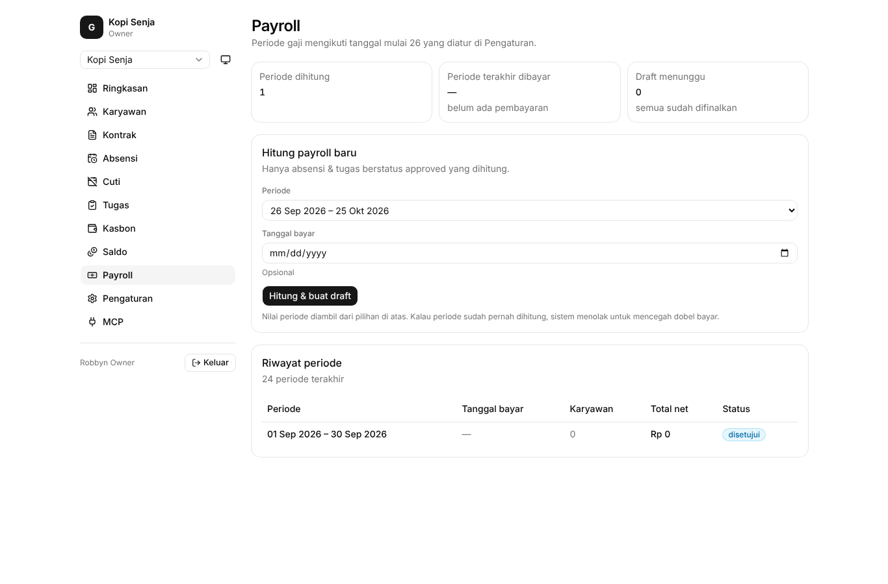
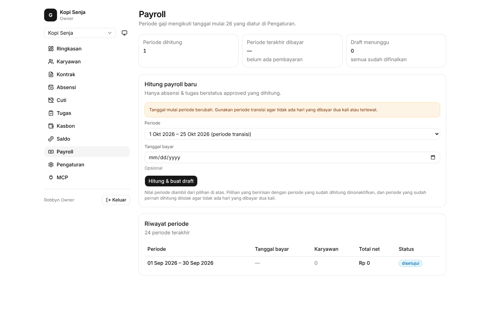
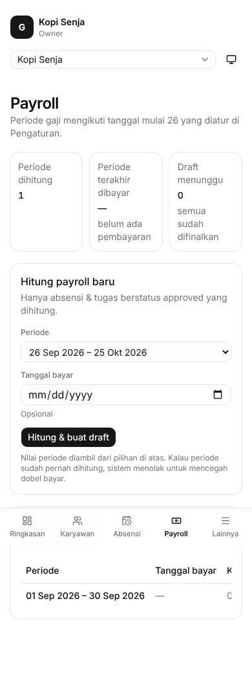
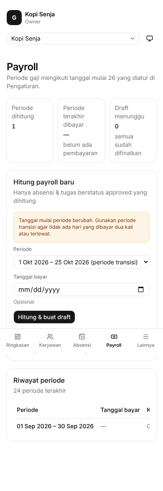
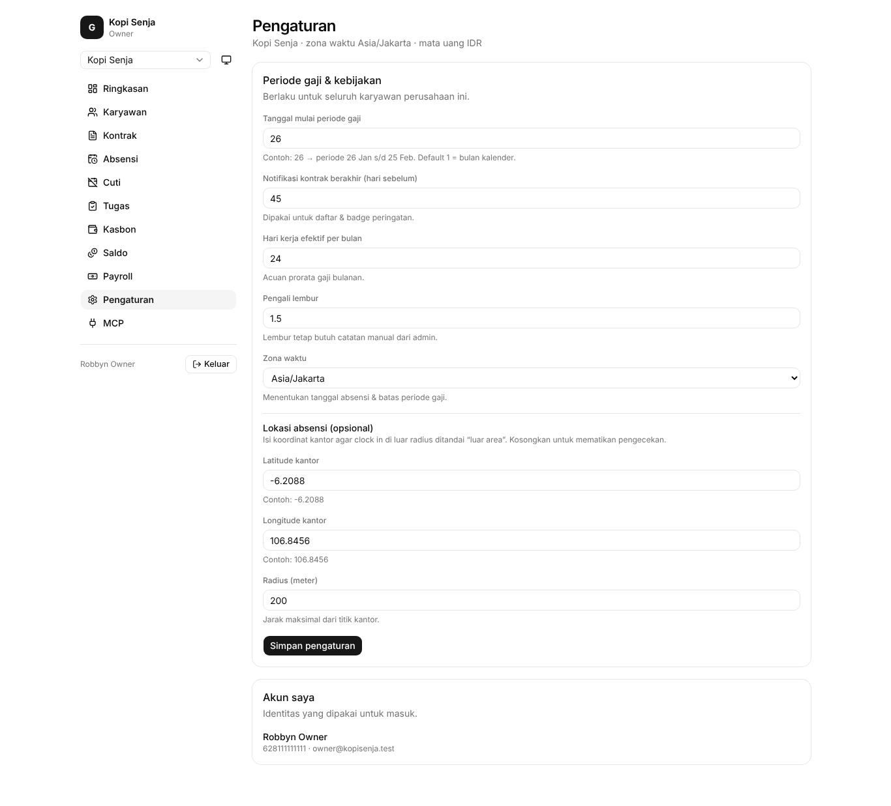
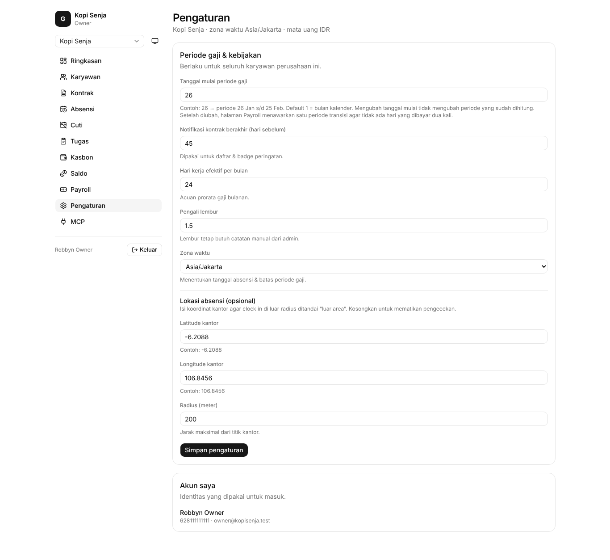
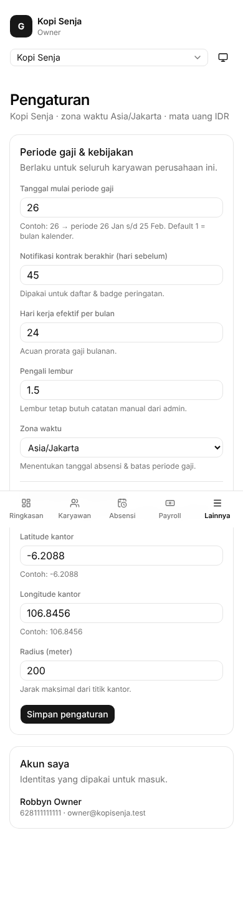
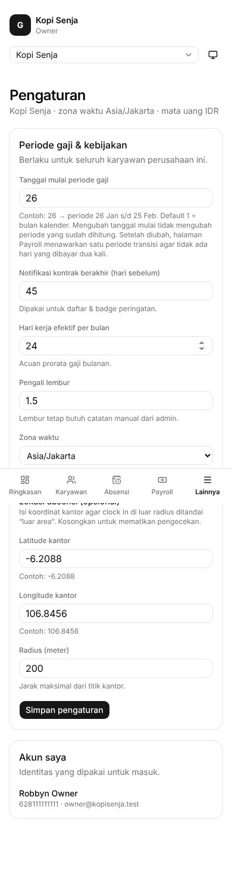

# Before / after: periode payroll beririsan (#48)

Skenario: periode 1–30 Sep sudah difinalkan, lalu tanggal mulai periode diubah ke 26.

## payroll (desktop)

| Before | After |
| --- | --- |
|  |  |

## payroll (mobile)

| Before | After |
| --- | --- |
|  |  |

## pengaturan (desktop)

| Before | After |
| --- | --- |
|  |  |

## pengaturan (mobile)

| Before | After |
| --- | --- |
|  |  |
