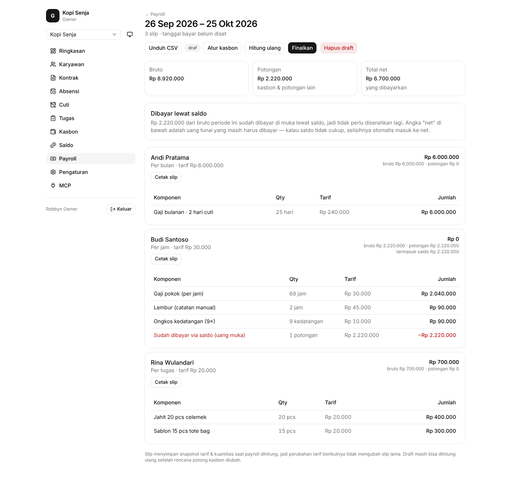
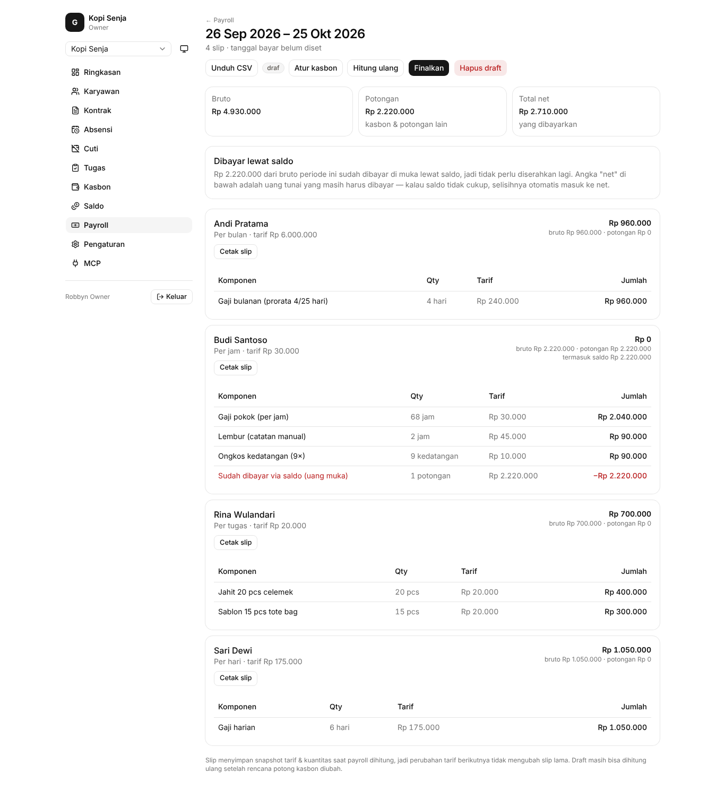
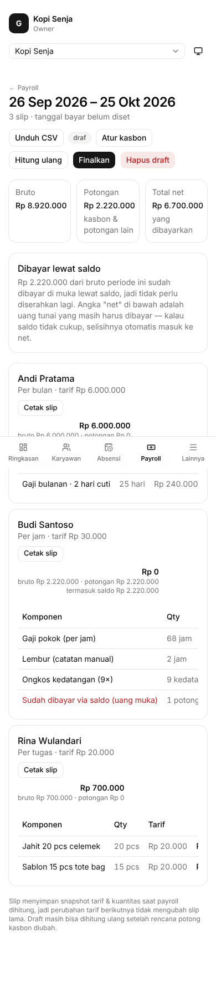
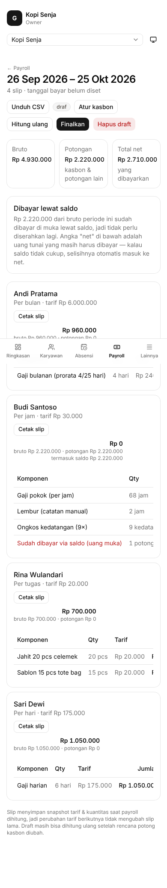
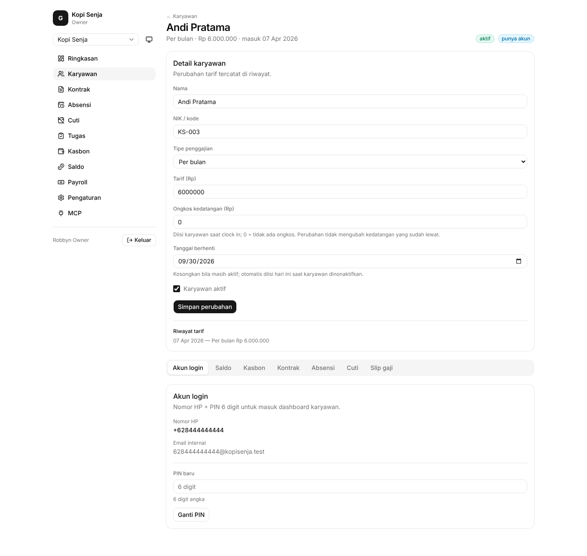
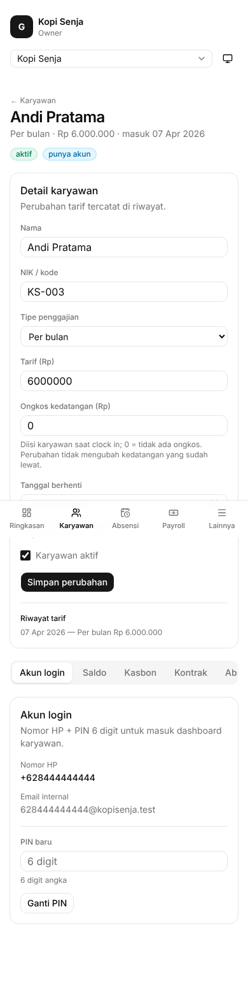

# Before / after #49 — tanggal berhenti

Data demo seed, periode 26 Sep – 25 Okt 2026:

- Andi Pratama (bulanan, Rp 6.000.000): masih aktif, tanggal berhenti 30 Sep (skenario A).
- Sari Dewi (harian): absensi approved 17–23 Okt, lalu dinonaktifkan dengan tanggal berhenti 23 Okt (skenario B).

Before: Andi dibayar penuh Rp 6.000.000, Sari tidak muncul. After: Andi Rp 960.000 (prorata 4/25 hari), Sari muncul dengan 6 hari = Rp 1.050.000.

## Payroll, desktop

| Before | After |
| --- | --- |
|  |  |

## Payroll, mobile

| Before | After |
| --- | --- |
|  |  |

## Form karyawan (hint tanggal berhenti), desktop

| Before | After |
| --- | --- |
|  |  |

## Form karyawan, mobile

| Before | After |
| --- | --- |
|  |  |
